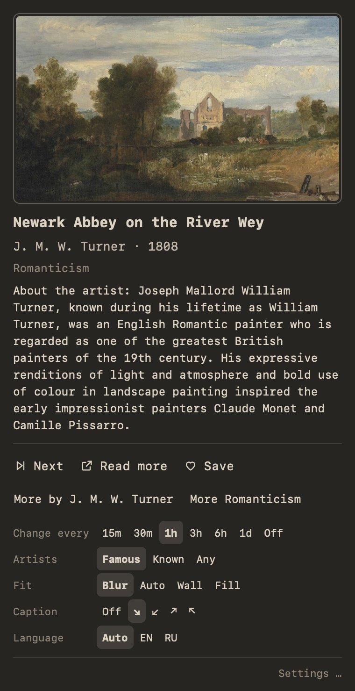
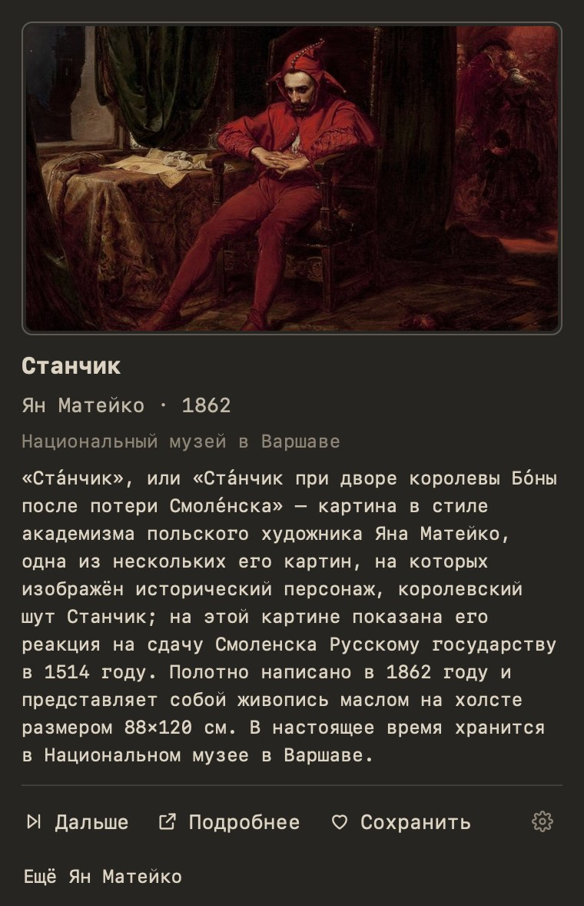

# Museum Wallpapers for macOS

Your desktop as a slow museum walk: an endless supply of public-domain
paintings from museums worldwide, a new one every hour (or whenever you like),
with the title, artist, year, museum and a short story one click away in the
menu bar.

The Mac version of the Omarchy plugin
[omarchy-museum-wallpapers](https://github.com/dpsk/omarchy-museum-wallpapers)
and of [Museum Wallpapers for Windows](https://github.com/dpsk/museum-wallpapers-windows):
the same painting picker, descriptions, filters, prefetch queue and Save, with
the plugin's popup card under a menu bar icon.

Website: **[nikaliuk.in](https://nikaliuk.in/)**

- **Endless and high-resolution.** Tens of thousands of paintings listed on
  Wikidata, shown from their Wikimedia Commons scans: only scans large enough
  for your screen (up to 4K), only landscape-shaped works, never tiles or
  detail crops.
- **Every display, every Space.** Each screen gets the painting sized for its
  Retina resolution, and a Space you switch to gets it too.
- **Know what you are looking at.** A small museum label in a corner of the
  wallpaper; click the menu bar icon for the card with the story, **Read
  more**, **Save**, **More by …** / **More Impressionism**, and the settings.
- **Famous painters first.** By default only the ~280 painters covered by 60+
  Wikipedias; widen it to ~1200 or to everyone.
- **Updates itself.** A new release is offered in the card and the menu;
  one click downloads, verifies and installs it, and restarts the app.
- **English or Russian, switched in the card.** The interface, titles, artists,
  museums and stories follow the language you pick (see
  [Languages](#languages)).

<p align="center">
  
  
</p>

<p align="center">
  
</p>

## Install

Download `MuseumWallpapers-<version>-apple-silicon.dmg` (M1 and later) or
`MuseumWallpapers-<version>-intel.dmg` from
[Releases](https://github.com/dpsk/museum-wallpapers-macos/releases), open it
and drag **Museum Wallpapers** onto **Applications**.

The app is not notarized by Apple, so the first start needs one extra step:

1. Open **Museum Wallpapers** from Applications. macOS says it cannot verify
   the app; click **Done**.
2. Open **System Settings → Privacy & Security**, scroll down to the message
   about Museum Wallpapers and click **Open Anyway**, then confirm.

Or, in Terminal: `xattr -dr com.apple.quarantine "/Applications/Museum Wallpapers.app"`.

A frame icon appears in the menu bar and the first painting follows within
about 15 seconds (the painter lists ship with the app and are refreshed from
Wikidata in the background). Requires macOS 13 Ventura or later and an internet
connection to Wikimedia.

## Using it

| Do | What happens |
| --- | --- |
| Hover the menu bar icon | Title and artist |
| Click it | The card: preview, title, artist, museum, story, **Next**, **Read more**, **Save**, **More by …**, and the settings |
| Right-click (or Control-click) it | Every setting as a menu, plus language, notifications, Open at login, the collection folder and Quit |
| Middle-click it | Next painting |
| Open the app again while it runs | Opens the card |

**Save** copies the painting to `~/Pictures/Museum Wallpapers` with a line in
`CREDITS.md`; that folder is also what is shown when there is no internet.

## Updates

Once a day the app asks GitHub whether a newer release is out (turn it off
with **Check for updates automatically** in the menu, or ask any time with
**Check for Updates…**). When there is one, you get a notification once, and
the card and the menu offer **Install and restart**, which:

1. downloads the release's `.dmg` for your Mac (Apple silicon or Intel) and
   checks it against the size and SHA-256 digest GitHub lists for it;
2. checks that the app inside is Museum Wallpapers, at that version, with an
   intact signature;
3. quits, puts the new app in place of the old one and opens it.

Nothing is installed without that click. When the app cannot replace itself
(it runs straight from the downloaded `.dmg`, or from a folder you cannot
write to), it opens the release page instead.

## Languages

The **Language** row of the card switches between **Auto** (the macOS
language), **EN** and **RU**; the menu also offers Ukrainian, German, French,
Spanish, Italian, Dutch, Polish and Portuguese for the paintings' text. The
choice changes the interface and everything said about the painting on screen
at once, including the caption on the wallpaper.

The language never narrows **which** paintings you get: painters are picked
by how many Wikipedias cover them and paintings from Wikidata and Commons,
whatever language you read in. Only the description changes, and falls back
when your language has nothing:

1. The painting's own Wikipedia article in your language.
2. The artist's article in your language ("О художнике: …").
3. The painting's English article, the description on Commons, the artist's
   English article. The card then says which language the story is in.

Titles, artists, museums and movements come from Wikidata labels in your
language, then English, then whatever language the item has (many paintings
are labelled only in their museum's language).

## Settings

All of these are in the card or the menu; they are stored in
`~/Library/Application Support/MuseumWallpapers/settings.json`, which you can
also edit by hand.

| Key | Default | Where | Meaning |
| --- | --- | --- | --- |
| `intervalMinutes` | `60` | Change every | Minutes between paintings; `0` changes only on demand |
| `fame` | `"famous"` | Artists | `famous` (~280 painters), `known` (~1200) or `any` |
| `fit` | `"blur"` | Fit | `blur` (framed by a blurred copy of itself), `auto` (fill unless that crops more than 10%), `wall` (on a dark wall), `cover` (fill and crop) |
| `caption` | `"bottom-right"` | Caption | `off`, `bottom-right`, `bottom-left`, `top-right`, `top-left` |
| `language` | `"auto"` | Language | Language of the interface and the descriptions; `auto` follows macOS |
| `notifyOnChange` | `false` | Menu | A notification with the painting each time it changes |
| `checkForUpdates` | `true` | Menu | Ask GitHub once a day for a newer version |
| `saveDir` | `~/Pictures/Museum Wallpapers` | Menu: Open collection folder | Where **Save** puts paintings; also the offline fallback |
| `prefetchCount` | `6` | | Paintings downloaded (and framed) ahead, so **Next** is instant |
| `cacheSize` | `24` | | Downloaded paintings kept |
| `minRatio`, `maxRatio` | `1.3`, `2.0` | | Accepted width/height ratios |
| `filters` | none | | `yearFrom`, `yearTo`, `artists`, `movements`, `genres`; see the [plugin's README](https://github.com/dpsk/omarchy-museum-wallpapers#filters) |

**Open at login** in the menu adds the app to System Settings → General →
Login Items (macOS may ask you to allow it there).

## Remove

Quit it from the menu, then move **Museum Wallpapers** from Applications to
the Bin, and delete its folders if you like:

```bash
rm -rf ~/Library/Application\ Support/MuseumWallpapers ~/Library/Caches/MuseumWallpapers ~/Library/Logs/MuseumWallpapers
```

Paintings you saved stay in `~/Pictures/Museum Wallpapers`. The wallpaper on
screen stays until you pick another one in System Settings → Wallpaper.

## Data, privacy and licensing

See [PRIVACY.md](PRIVACY.md).

The app talks to Wikimedia (`commons.wikimedia.org`, `upload.wikimedia.org`,
`www.wikidata.org`, `query.wikidata.org` and `*.wikipedia.org`) and, to look
for updates, to GitHub (`api.github.com`, and `github.com` when downloading
one). Requests carry a User-Agent naming this app and nothing about you.

The images are photographs of public-domain paintings. Stories are excerpts
from Wikipedia (CC BY-SA); **Read more** links to the source article.

## Troubleshooting

- **Nothing changes:** click the menu bar icon: the card shows the last error;
  the log is `~/Library/Logs/MuseumWallpapers/museum-wallpapers.log` (also in
  Console.app).
- **Check the installation:**
  `"/Applications/Museum Wallpapers.app/Contents/MacOS/MuseumWallpapers" selftest`
  prints a JSON report; every check should say `"ok": true`.
- **A wallpaper managed by your organisation** (a configuration profile) wins
  over any app; Museum Wallpapers cannot change it.
- **Another Space shows an old wallpaper:** it is replaced when you switch to
  it; turning on *Show on all Spaces* in System Settings → Wallpaper avoids
  the switch.

## Development

```bash
python3 -m venv .venv && .venv/bin/pip install -r requirements-dev.txt
.venv/bin/python -m pytest                        # unit tests (any OS; macOS-only ones skip elsewhere)
PYTHONPATH=src .venv/bin/python -m museum_wallpapers         # the menu bar app
PYTHONPATH=src .venv/bin/python -m museum_wallpapers next    # core commands: tick, next, status, keep, filter …
PYTHONPATH=src .venv/bin/python -m museum_wallpapers selftest
.venv/bin/python packaging/build.py               # macOS only: the .app, its self-test and the .dmg
```

`MUSEUM_WALLPAPERS_PLATFORM=dev` runs the whole rotation against a fake
desktop (the "wallpaper" is a JSON file in the state folder;
`MUSEUM_WALLPAPERS_SCREEN=3456x2234,2560x1440` sets the screens), so the app
can be tried without touching the real wallpaper. `MUSEUM_WALLPAPERS_HOME`
puts all folders under one directory, and `MUSEUM_WALLPAPERS_SNAPSHOT=card.png`
saves a picture of the card when it opens.

Layout:

| Path | What |
| --- | --- |
| `src/museum_wallpapers/core.py` | Picking, describing, queue, Save, filters, commands (shared with the Windows app and the plugin) |
| `src/museum_wallpapers/platforms/` | What the OS does: `macos.py` (NSWorkspace wallpaper per screen, NSScreen, notifications, Open at login), `base.py` (interface + dev stand-in) |
| `src/museum_wallpapers/framing.py` | Blur / wall / fill framing and the caption, with Pillow |
| `src/museum_wallpapers/app.py` | What the menu bar app does: scheduler, actions, menu, updates (no AppKit, tested anywhere) |
| `src/museum_wallpapers/updater.py` | Finding, downloading, verifying and installing a newer release |
| `src/museum_wallpapers/macui.py`, `card.py` | Status item, menu and popover (AppKit); the card page (HTML in a WKWebView) |
| `packaging/` | PyInstaller spec and the build script (app bundle, ad-hoc signature, self-test, .dmg) |
| `.github/workflows/build.yml` | Tests on Linux and macOS, builds the Apple silicon and Intel .dmg, attaches them to `v*` releases |

What is left before the first release: [HANDOFF.md](HANDOFF.md).

## License

MIT
